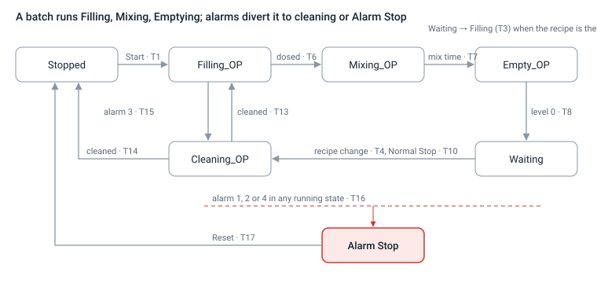

# VC_ARG_04 · Operation specification v4.1

Nov 1, 2026 · @Maki

Project: Vibe Coding Industrial, Digitalización Férriz. Process specification of the 100 L batch mixing tank, consolidated from v4.0 with the decisions taken in the simulation review of 01.11.2026. Changes from v4.0 are listed in Annex A and marked **[4.1]** in the text.

## 1 Purpose and scope

This document specifies how the 100 L batch mixing tank operates: equipment, parameters, master data rules, operating rules, state machine, alarms, interface variables, operator HMI, report, analytics and the reference simulation scenario. It is a process specification only and stands on its own.

Valves are on/off; flow rates are constant. The scrap and recycle destinations are unlimited sinks.

The process logic lives in the controller (Node-RED); the HMI shows state and sends commands. The reference simulator (section 14) implements the same logic in Python.

The Emergency Stop is an operator command in software and is not a safety function.

Out of scope in this version: lot ID, level-controlled (closed-loop) dosing, keeping the product of a stopped batch (partial batches), automatic changes to order volumes during production.

Every report and dashboard is headed **VC_ARG_04**. **[4.1]** The header stays VC_ARG_04 for every 4.x version and replaces any older header found in a template (for example VC_ARG_03).

## 2 Equipment and tags

| Item | Tag | Notes |
|---|---|---|
| Tank | 100 L | 1 L = 1 % of the volume |
| Mixer motor | MOT | On/off |
| Product inlets | IN_P1, IN_P2, IN_P3 | One open at a time in normal operation |
| Cleaning inlet | IN_CLEAN | Cleaning liquid |
| Final product outlet | OUT_NORMAL | Normal discharge |
| Scrap outlet | OUT_SCRAP | Unlimited sink |
| Recycle outlet | OUT_RECYCLE | Cleaning liquid to the recycling tank |

## 3 Process parameters

| Parameter | Value | Notes |
|---|---|---|
| Fill rate IN_P1, IN_P2 | 1.0 L/s | |
| Fill rate IN_P3 | 0.5 L/s | |
| Fill rate IN_CLEAN | 1.0 L/s | To be confirmed |
| Discharge OUT_NORMAL | 0.2 L/s | Final product |
| Discharge OUT_SCRAP, OUT_RECYCLE | 1.0 L/s | |
| Production mixing time per recipe | Integer seconds, 5–600 s | |
| Cleaning mixing time | 300 s | Configurable |
| Cleaning liquid volume | 40 L | Fixed |
| Batch volume | 40–100 L, integer | Minimum 40 L applies to every recipe |
| Fill deviation tolerance | min(5 % of the planned dose, 1.0 L) | Per product; strictly greater triggers alarm 3 |
| Overflow limit | level > 101 L | Strictly greater |
| Product rounding | 0.1 L, half up | Prd_1 and Prd_2 rounded; the remainder rule below |
| **[4.1]** Dose duration | planned dose ÷ nominal flow | Dosing is time-based (section 5, rule 13) |
| **[4.1]** Progress window (alarm 4) | 15 s, consecutive windows | Section 7 |

## 4 Master data and order rules

**Recipe attributes:** Recipe ID (R###), percentages of Prd_1, Prd_2 and Prd_3 (integers adding up to exactly 100), mixing time (integer seconds, 5–600) and Approved (YES or NO). Only approved recipes can run. **[4.1]** Prd_2 or Prd_3 may be 0 %; a product with 0 % is skipped. A recipe with a missing or invalid attribute is not valid.

**Planned volumes.** Prd_1 and Prd_2 are the batch volume times their percentage, rounded half up to 0.1 L; Prd_3 is the batch volume minus the other two. If Prd_3 is 0 % the remainder goes to the last non-zero product. Example: R005 (50/25/25) at 45 L gives 22.5 + 11.3 + 11.2 L. Rounding is done in decimal arithmetic, not binary floating point.

**Production order attributes:** order number, Batch ID, Recipe ID, volume (integer litres). Orders run in list order.

Batch ID is text and unique. The suffix .n marks the sub-batches of one order; sub-batches share the recipe and are at most 100 L each.

Allowed batch volume 40–100 L. A pending batch with a volume outside this range, or with a recipe that is not approved or not valid, raises alarm 6 (section 7). The order list itself may contain volumes from 20 to 100 L, so that short last sub-batches can be rebalanced.

A list is rejected, and no batch starts, if it has a duplicate Batch ID, an unknown recipe, a non-integer volume or a recipe with percentages not adding up to 100.

**Sub-batch rebalancing rule (order preparation).** When the last sub-batch of an order is below the minimum volume, the shortfall is taken from the immediately preceding sub-batch, provided that one stays at or above the minimum; otherwise from the one before it. The order total does not change. For example, 100 + 100 + 35 L becomes 100 + 95 + 40 L; 100 + 20 L becomes 80 + 40 L. A single batch below the minimum has no sibling and is handled by alarm 6. **[4.1]** Rebalancing is done when the order list is prepared, before the first sub-batch starts, and produces a new file named after the original with `Template` replaced by `REBALANCED` (for example `VC_ARG_03_Production_Orders_REBALANCED.xlsx`); the original list is kept unchanged. The process itself never changes an order volume.

## 5 Operating rules

1. **Batch start.** The HMI shows the next pending batch (number, Batch ID, recipe, planned volume, mixing time). The operator types an integer volume (40–100 L) and presses Start for each batch.
2. **Volume discrepancy.** If the typed volume differs from the order volume, the process asks for confirmation. If confirmed, the typed volume is used and the report remarks "Volume order X L, entered Y L, confirmed by operator". If cancelled, nothing starts. A typed volume out of range is rejected with no dialog.
3. **Batch allowed.** When a batch becomes the pending one (state Stopped or Waiting) it is checked: volume 40–100 L, recipe valid and approved. If not, alarm 6 is raised (rule 11). A repeat after an alarm is not checked again.
4. **Start validity.** Valid data, no active emergency alarm (1, 2 or 4), no active alarm 6, a pending batch exists, state Stopped or Waiting.
5. **Cleaning criterion.** A pre-batch cleaning is required when the recipe differs from that of the last batch actually produced, or the last recipe is unknown (after an alarm). A cancelled batch does not change the last recipe. A Start from Stopped with a clean tank goes straight to Filling (T1, T18).
6. **Initial state.** Stopped, tank clean, last recipe empty. The first batch needs no cleaning.
7. **Cleaning_OP sub-steps.** (a) scrap, only if level > 0; (b1) fill IN_CLEAN to 40 L with the motor on; (b2) mix with the motor on for the cleaning mixing time; (c) drain to OUT_RECYCLE until level = 0.
8. **Normal Stop.** From Filling, Mixing or Emptying: the batch finishes, then Cleaning_OP, then Stopped. From Waiting: Cleaning_OP, then Stopped. During a pre-batch cleaning: the cleaning finishes, then Stopped, and the batch stays pending. It cannot be cancelled once pressed. An alarm cancels a pending Normal Stop.
9. **After an alarm (1 to 5)** the batch is always repeated in full (same recipe and volume, no new confirmation). An unfinished pre-batch cleaning keeps the order pending. **[4.1]** The aborted order is carried by its repeat record; the list moves on to the next order only after the repeat completes.
10. **End of list.** After the last batch the HMI shows LIST COMPLETE; Start is refused; the operator uses Normal Stop (final cleaning).
11. **Cancel batch.** With alarm 6 active the operator presses Cancel batch. The batch is closed as SKIPPED and the next order becomes pending. Start is refused while alarm 6 is active and the volume dialog cannot override it.
12. **After emergency alarms.** Alarms 1, 2 and 4 need Reset; Reset is refused while the cause is still present. Alarm 3 ends in Stopped and is acknowledged by the next Start.
13. **[4.1] Dosing.** Each product is dosed by time: its inlet stays open for planned dose ÷ nominal flow, then closes. The delivered dose is the level after minus the level before and is checked against the tolerance (alarm 3). A deviation inside the tolerance is written in Remarks.

## 6 State machine and transitions

Seven states, no Pause. Internal flags: `tankDirty`, `lastRecipe` (empty = unknown), `stopReq`, `retryPending`, `cleanReason` (PRE_BATCH, STOP, ALARM), `batchRejected` (alarm 6).

| stEtapa | State | Meaning |
|---|---|---|
| 0 | Stopped | Clean tank, or process disabled |
| 1 | Filling_OP | Doses products one at a time (stProducto 1–3) |
| 2 | Mixing_OP | Motor on for the recipe's mixing time |
| 3 | Empty_OP | Normal discharge at 0.2 L/s |
| 4 | Waiting | Empty, dirty tank, between batches |
| 5 | Cleaning_OP | Sub-step in stSubLimpieza (0 none, 1 scrap, 2 fill, 3 mix, 4 drain) |
| 9 | Alarm Stop | Emergency alarms 1, 2 and 4 |

| # | From | Event / condition | To | Actions |
|---|---|---|---|---|
| T1 | Stopped | Start valid, tank clean | Filling_OP | Row IN stamped |
| T2 | Stopped | Start valid, tank dirty (after an emergency alarm) | Cleaning_OP (PRE_BATCH) | |
| T3 | Waiting | Start valid, same recipe as last | Filling_OP | |
| T4 | Waiting | Start valid, different or unknown recipe | Cleaning_OP (PRE_BATCH) | |
| T5 | Filling_OP | Product dosed within tolerance, more products follow | Filling_OP (next product) | Skips 0 % products |
| T6 | Filling_OP | Last product dosed within tolerance | Mixing_OP | |
| T7 | Mixing_OP | Recipe mixing time elapsed | Empty_OP | |
| T8 | Empty_OP | Level 0, no Normal Stop pending | Waiting | Row COMPLETED, OUT stamped, tank dirty, last recipe set |
| T9 | Empty_OP | Level 0, Normal Stop pending | Cleaning_OP (STOP) | As T8, then cleaning |
| T10 | Waiting | Normal Stop | Cleaning_OP (STOP) | |
| T11 | Filling, Mixing, Empty | Normal Stop | same | stopReq set |
| T12 | Cleaning_OP (PRE_BATCH) | Normal Stop | same | stopReq set |
| T13 | Cleaning_OP (PRE_BATCH) | Finished, no stopReq | Filling_OP | Tank clean, cleaning time to the row |
| T14 | Cleaning_OP | Finished with stopReq, or reason STOP or ALARM | Stopped | Tank clean |
| T15 | Filling_OP | Alarm 3 | Cleaning_OP (ALARM) | Row ABORTED, scrap, clean, Stopped, repeat pending |
| T16 | Any running state | Alarm 1, 2 or 4 | Alarm Stop | Everything off, level frozen; row ABORTED if a batch was active; alarm 5 if product was already discharged |
| T17 | Alarm Stop | Reset, cause cleared | Stopped | Tank dirty, last recipe unknown |
| T18 | Stopped (after alarm 3) | Start | Filling_OP | Acknowledges alarm 3; repeat as a new row |
| T19 | Stopped, Waiting | Pending batch not allowed (volume or recipe) | same | Alarm 6 raised; Start refused |
| T20 | Stopped, Waiting | Cancel batch with alarm 6 active | same | Row SKIPPED, alarm cleared, next order pending and checked |

"Any running state" means Filling, Mixing, Emptying, Waiting and Cleaning (not Stopped).

Waiting also goes straight to Filling (T3) when the next recipe equals the last one. Alarm 3 diverts a batch to a cleaning; alarms 1, 2 and 4 stop the machine until Reset. Alarm 6 (T19, T20) changes no state: the machine waits in Stopped or Waiting for Cancel batch.

## 7 Alarms 1 to 6

| Code | Alarm | Class | Detection |
|---|---|---|---|
| 0 | No alarm | | |
| 1 | Overflow | Emergency (Alarm Stop) | Level crosses 101 L with any inlet open; latched until Reset. Also active during cleaning |
| 2 | Emergency Stop | Emergency (Alarm Stop) | Operator command in any running state, including Waiting |
| 3 | Fill deviation | Controlled | After each product, \|delivered − planned\| > min(5 % of planned, 1.0 L). Delivered = level after − level before |
| 4 | Step timeout / no progress | Emergency (Alarm Stop) | See below |
| 5 | Partial batch | Warning, raised with its cause | Alarm 1, 2 or 4 during Emptying after product was discharged to OUT_NORMAL |
| 6 | Batch not allowed | Warning, blocks Start (no Alarm Stop) | The pending batch has a volume below 40 L or above 100 L, or a recipe that is not approved or not valid. Raised when the batch becomes pending; cleared by Cancel batch |

**Alarm 3.** The batch is aborted, its content goes to scrap, the tank is cleaned and the machine stops; the next Start repeats the batch.

**Alarm 4 (progress monitor).** Active in Filling (during a dose), Emptying and the cleaning scrap, fill and drain steps. Over a 15 s window the level must move in the expected direction by at least 20 % of the expected change (expected rate = nominal flow of the open valve). **[4.1]** Windows are consecutive and start with the step; a last window shorter than 15 s is not judged. A step also times out when it exceeds 1.5 × its expected duration + 10 s. It detects an inlet with no flow, an outlet stuck closed, and the deadlock where a stuck-open inlet (1 L/s) equals the scrap or recycle drain (1 L/s). Mixing is time-controlled and not monitored. Reset needs the cause cleared.

**[4.1] Cause of an emergency alarm (for Reset).** Alarm 1: level above 101 L with an inlet open. Alarm 2: none once pressed. Alarm 4: the failing device (no flow, stuck valve) is still failing. A valve that is stuck open closes when the Alarm Stop removes its power.

**Alarm 6.** The alarm text names the reason: `Volume 35 L below minimum 40 L`, `Volume 120 L above maximum 100 L`, `Recipe R### not approved`, `Recipe R### not valid`. The machine stays in Stopped or Waiting with the tank unchanged; Normal Stop and Emergency Stop (from Waiting) keep working. The only way forward is Cancel batch. The batch is not repeated and does not count as aborted.

**Priority.** 1, 2 and 4 before 3. Alarm 5 is always raised together with its cause. Alarm 6 can only occur when no batch is running.

**Overflow precedence.** On a full 100 L batch the last product has only 1 L of headroom below the limit, so an excess flow on it raises alarm 1 before the end-of-dose check can raise alarm 3.

**Reset and Start.** Reset is refused while the cause of an emergency alarm is still present. After alarm 3, Start is accepted even if the cause is still present; the repeat then trips again.

## 8 Output matrix

| State / sub-step | IN_P1 | IN_P2 | IN_P3 | IN_CLEAN | OUT_NORMAL | OUT_SCRAP | OUT_RECYCLE | MOT |
|---|---|---|---|---|---|---|---|---|
| Stopped, Waiting, Alarm Stop | 0 | 0 | 0 | 0 | 0 | 0 | 0 | 0 |
| Filling_OP | one of the three, matching stProducto | | | 0 | 0 | 0 | 0 | 0 |
| Mixing_OP | 0 | 0 | 0 | 0 | 0 | 0 | 0 | 1 |
| Empty_OP | 0 | 0 | 0 | 0 | 1 | 0 | 0 | 0 |
| Cleaning (a) scrap | 0 | 0 | 0 | 0 | 0 | 1 | 0 | 0 |
| Cleaning (b1) fill | 0 | 0 | 0 | 1 | 0 | 0 | 0 | 1 |
| Cleaning (b2) mix | 0 | 0 | 0 | 0 | 0 | 0 | 0 | 1 |
| Cleaning (c) drain | 0 | 0 | 0 | 0 | 0 | 0 | 1 | 0 |

Alarm 6 changes no output.

## 9 Scrap, partial batch and cancelled batch

Scrap is what is drained through OUT_SCRAP (the scrap step of a cleaning). Cleaning liquid sent to OUT_RECYCLE is not scrap. **[4.1]** Cleaning liquid left in the tank by an interrupted cleaning and drained through OUT_SCRAP in the next cleaning counts as scrap.

Scrap is attributed to the row that caused it: the scrap of a pre-batch cleaning to the batch about to start (after an emergency alarm this is the repeat record), the scrap of a post-alarm cleaning to the aborted row. The report shows it in Remarks ("Scrap x.x L", one decimal) and its summary (exact value); the HMI and the analytics show the scrap of the current batch and the running total.

**Partial batch.** When alarm 1, 2 or 4 stops a batch during Emptying after product has gone to OUT_NORMAL, the row is ABORTED and ALARMS holds the cause and `5 – Partial batch`. Remarks gives the litres already discharged and left in the tank. After Reset the next Start cleans (the left-over product goes to scrap) and repeats the batch in full.

**Cancelled batch (alarm 6).** The row keeps STATUS SKIPPED and ALARMS `6 – Batch not allowed`. Remarks gives the reason, the ordered volume and "Cancelled by operator". IN, OUT, process time, cleaning time and produced volume stay blank. There is no repeat row. The ordered volume counts as not produced. The last recipe and the tank state are unchanged, so the next batch is compared with the last batch actually produced.

## 10 Interface variables

Message contract between controller and HMI: readings topic `estado` (full snapshot), commands topic `orden`.

**Commands (HMI to controller)**

| Variable | Type | Notes |
|---|---|---|
| cmdMarcha | BOOL pulse | Start, carries volLote_L |
| volLote_L | UINT | 40–100, integer |
| cmdConfirmaVol / cmdCancelaVol | BOOL pulse | Answer to the volume dialog |
| cmdParo | BOOL pulse | Normal Stop |
| cmdParoEmerg | BOOL pulse | Emergency Stop |
| cmdRearme | BOOL pulse | Reset |
| cmdCancelaLote | BOOL pulse | Cancel batch; accepted only with alarm 6 active |

**Readings (controller to HMI)**

| Variable | Type | Notes |
|---|---|---|
| pvNivel_L | REAL | Normal range 0 to about 103 L; the HMI accepts 0–130 |
| stEtapa | UINT | 0–5, 9 |
| stSubLimpieza, stProducto | UINT | 0–4 and 0–3 |
| stMotivoLimpieza | UINT | 0 none, 1 pre-batch, 2 stop, 3 after alarm |
| stIN_P1, stIN_P2, stIN_P3, stIN_CLEAN | BOOL | |
| stOUT_NORMAL, stOUT_SCRAP, stOUT_RECYCLE | BOOL | |
| stAgitador | BOOL | (stMOT in the simulator log) |
| stAlarma | UINT | 0–6 |
| stAlarmaOrigen | UINT | 0 none, 1 machine, 2 operator |
| stAlarmaTexto | STRING | Detail, including the alarm 6 reason |
| stMensaje | STRING | Process feedback (rejections, refusals) |
| stTanqueSucio, stParoSolicitado, stReintento | BOOL | |
| stConfirmaVol, stListaCompleta | BOOL | Volume dialog; no pending batch |
| stLoteParcial | BOOL | Alarm 5 active |
| stLoteRechazado | BOOL | Alarm 6 active |
| recetaAprobada | BOOL | |
| loteIdx, loteTotal | UINT | |
| loteId, recetaId, ultimaReceta | STRING | |
| volOrden_L, volLote_L | REAL | Order volume, entered volume |
| recPct_P1..P3 | REAL | Recipe percentages of the current batch |
| tMezclaRec_s | REAL | Mixing time of the current recipe |
| plan_P1..P3_L, dos_P1..P3_L | REAL | Planned and delivered |
| volDescargado_L | REAL | Litres discharged to OUT_NORMAL for the current or last batch |
| volScrapLote_L, volScrapTotal_L | REAL | Scrap of the current batch, running total |
| tEtapa_s | REAL | Elapsed time in the step |
| kpiLotesOK, kpiLotesAbort, kpiLotesCancel, kpiLimpiezas | UINT | Counters |
| kpiUltimoCiclo_s, volNoProducido_L | REAL | Last cycle time; litres not produced |

The HMI rejects an incomplete or out-of-range snapshot, names the first offending field and keeps the last valid reading.

## 11 Operator HMI requirements

**Process view:** tank with a 0–100 L scale (1 L = 1 %) and a batch-volume marker (a 40 L marker during cleaning), four inlet valves, three outlet valves, motor and agitator, flow animation. Every state also appears as text (OPEN, CLOSED, RUNNING, STOPPED). Cleaning liquid is shown in a distinct colour.

**Batch data:** Batch ID, recipe, order volume, mixing time, planned and delivered volume per product, litres discharged, scrap of the current batch and running total.

**Alarm field:** code, name and detail text for alarms 1 to 6; Alarm 5 and 6 are shown with the alarm that caused them or with the batch that was rejected.

**Volume entry:** integer field, 40–100 L, validated before Start; editable only in Stopped or Waiting; a repeat keeps the interrupted volume; the confirmation dialog of rule 2. **[4.1]** This is the only operator setpoint: the mixing time comes from the recipe and is not entered at the HMI.

**Buttons and when they are enabled:**

| Button | Enabled |
|---|---|
| Start | Stopped or Waiting, allowed batch, valid volume (a repeat keeps the interrupted volume) |
| Normal Stop | Filling, Mixing, Emptying, Waiting, pre-batch cleaning; once per batch |
| Emergency Stop | Every running state |
| Reset | Alarm Stop only |
| Cancel batch | Alarm 6 only |

Each valid press sends one true pulse with a 500 ms guard against double sends; nothing is sent on release.

Footer text: "Emergency Stop is not a safety function".

**[4.1] Layout (single view "Batch Mixing Tank").** 16:9, designed at 1920 × 1080 for Full HD recording. Bluish-grey background, white panels, Roboto, blue and orange accents. Header: logo on the left with its credit at 10 px, title, state shown as text and colour, clock. Left column: batch and operator commands (volume entry and the five buttons), dosing table, alarm field, counters. Right: process view with the tank, pipes, valves, agitator and setpoint marker, plus the latest events. Footer left: author credit; footer right: the safety footer text. Indicators never rely on colour alone.

## 12 Production Order Report

One record per production order, created as PENDING when the list is loaded and filled as production progresses. Header: VC_ARG_04.

| Column | Content |
|---|---|
| # | Record number. Orders are 1 to N; repeats are appended at the end |
| Batch ID | Text, for example 0006.1 |
| Recipe | Recipe ID |
| Vol. order (L) | Volume of the order |
| Vol. produced (L) | Sum of the delivered doses of a COMPLETED batch; blank otherwise |
| IN | Start of Filling_OP, dd.mm.yyyy hh:mm:ss |
| OUT | End of Empty_OP (COMPLETED) or the alarm instant (ABORTED) |
| Process time (s) | OUT − IN (fill, mix, empty only) |
| Cleaning time (s) | Completed cleaning associated with the record (see below) |
| STATUS | PENDING, RUNNING, COMPLETED, ABORTED (ALARM), SKIPPED (cancelled after alarm 6) |
| ALARMS | code – name, several separated by `; `, for example `2 – Emergency Stop; 5 – Partial batch` or `6 – Batch not allowed` |
| Remarks | Alarm detail, volume discrepancy, retry reference, scrap, partial discharge, cancellation reason, final cleaning, cleaning breakdown |

Rules:

- An aborted batch keeps its record as ABORTED. The repeat is a new record appended at the end with the same Batch ID and Remarks `Retry of #m`, where m is the record it repeats. Repeats are not in chronological order; the timestamps are.
- A cancelled batch (alarm 6) keeps its record with STATUS SKIPPED, ALARMS `6 – Batch not allowed` and the reason and "Cancelled by operator" in Remarks. IN, OUT, process time, cleaning time and produced volume are blank; there is no repeat record.
- Cleaning time is the pre-batch cleaning completed before the batch started. On an aborted record it also includes the cleaning that follows its alarm; when both exist Remarks gives the breakdown. A cleaning after a Normal Stop is written in the Remarks of the last batch. A cleaning interrupted by an alarm is noted in the Remarks of the next record.
- A fill deviation inside the tolerance is written in Remarks. A produced volume different from the order volume gets a Remarks comment.
- Scrap is written as `Scrap x.x L` in the Remarks of the record that caused it.
- **[4.1]** In a simulation, IN and OUT are on the simulated clock.

A summary accompanies the report: records, completed, aborted, skipped, alarms by code 1 to 6 (rows and event log), litres produced, litres not produced, total cleaning time (column, and including Normal Stop cleanings), first IN, last OUT, duration, cleanings completed, scrap generated, partial batches.

An event log keeps every command, fault injection (simulation), state change, alarm and refusal with its clock time, including alarms that have no record (for example during a pre-batch cleaning). **[4.1]** The event log has no row limit.

**[4.1] Test results (simulation).** A sheet lists each scenario, the specification expectation, what was observed and PASS, FAIL or OBSERVATION. Every PASS is computed by a check in the simulator code.

## 13 Production analytics

A dashboard headed VC_ARG_04 presents the report and the event log, labelled as simulated data when it comes from the simulator. Definitions:

| Indicator | Definition |
|---|---|
| Batches completed, aborted, skipped | Records by STATUS |
| Alarms raised | Count per code 1 to 6 from the event log |
| Cleanings finished | Cleanings that reached the end of the drain step |
| Litres produced | Sum of Vol. produced |
| Litres not produced | Sum of Vol. order of SKIPPED records |
| Scrap generated | Litres drained through OUT_SCRAP |
| Time making good product | Share of the elapsed time spent in Filling, Mixing and Emptying of batches that were completed |

Views: tank level over time with the overflow limit, a state strip and alarm markers by code; time by activity; alarms by type; valve and motor on-time; litres per batch (produced, ordered and aborted, cancelled shown distinctly); cumulative litres produced and scrap; alarm log; report table. A legend is shown whenever there are two or more series, status is never by colour alone, and every chart has a tooltip.

## 14 [4.1] Simulation and test scenario

**Simulator.** Python, 100 ms tick, volumes in integer centilitres, simulated clock starting at 06:30:00 CET on the run date. It reads the recipes file (sheet `recipes`, by position A–G) and the rebalanced order list (sheet `today`, A–D), runs sections 4 to 9, and writes the report (section 12), the event log, a 5 s log (state, sub-step, product, level, outputs, alarm, batch index, report row, scrap total) and the data for the dashboard and the HMI.

**Operator model.** Every operator action happens after a random reaction time of 3–8 s (seed 7). The operator types the order volume and presses Start for each pending batch; with alarm 6 active tries Start once (refused) and then presses Cancel batch; presses Reset in Alarm Stop, and after a refused Reset waits for the repair before trying again; at LIST COMPLETE tries Start once (refused) and then presses Normal Stop.

**Faults.** Each fault is armed 0.5 s after its batch becomes pending, fires at the step shown and acts once.

| # | Batch | Injection | Expected |
|---|---|---|---|
| F1 | 0003.0 | Operator types 50 L (order 45 L) and confirms | Rule 2 remark |
| F2 | 0005.0 | Operator types 110 L, then 90 L and cancels, then 100 L | 110 L rejected without dialog; cancel starts nothing |
| F3 | 0007.0 | IN_P1 flow +10 % during the Prd_1 dose | Alarm 3, T15, retry, T18 |
| F4 | 0013.0 | IN_P3 flow +20 % on the last dose of 100 L | Alarm 1 before alarm 3 |
| F5 | 0020.0 | IN_P2 no flow, repaired 60 s after the alarm | Alarm 4; first Reset refused |
| F6 | 0022.0 | IN_CLEAN stuck open in the drain of the pre-batch cleaning | Alarm 4 deadlock, no report row |
| F7 | 0026.1 | Emergency Stop at 50 % of Emptying | Alarms 2 and 5 |
| F8 | 0024.0 | Emergency Stop in Waiting | Alarm 2, no row aborted |
| F9 | 0017.1 | Normal Stop during Mixing | T11, T9, final-cleaning remark |
| F10 | 0029.0 | Normal Stop during the pre-batch cleaning | T12, T14, batch stays pending |

Alarm 6 comes from the data (R002 not approved; 0028.0 at 20 L).

**Acceptance.** The totals (records, completed, aborted, skipped, litres produced, scrap, cleanings, alarms by code) recomputed from the rows and the events agree across the report, the dashboard and the summary; the level never exceeds the overflow limit by more than one tick of flow; the outputs match section 8 at every tick; every transition T1–T20 and every alarm 1–6 is exercised.

## 15 Open points

**To confirm**

1. Fill rate of IN_CLEAN (1.0 L/s).
2. Cleaning mixing time (300 s, configurable).
3. Mixing time range 5–600 s.
4. The 40 L minimum for every recipe, or a minimum per recipe.
5. Alarm 6 also covers volume above 100 L and recipes that are not approved or not valid; the volume dialog cannot override it.
6. **[4.1]** Time-based dosing (rule 13) as the reference behaviour of the controller.
7. **[4.1]** A 0 % share allowed for Prd_2 as well as Prd_3 (recipe R004).
8. **[4.1]** Cleaning liquid drained through OUT_SCRAP counted as scrap (section 9).
9. **[4.1]** Consecutive 15 s windows for alarm 4 (a rolling window would detect slightly earlier).
10. **[4.1]** Template fixes: recipes data validation (rows 26–41 limit the mixing time to 100 s; rows 2–25 do not validate it), the recipes Rules sheet (the simulator reads columns A to G), the orders Rules sheet (40 L minimum, alarm 6 instead of rejection, rebalancing), and the VC_ARG_03 headers.

**Resolved in 4.1**

- The header number stays VC_ARG_04 (was open point 6).

**Future improvements**

- Partial batches: keep the product and resume.
- Mixing time depending on the batch volume (today one value per recipe).
- Merging a cancelled volume into the next order of the same recipe; automatic rebalancing of sub-batches in the controller.
- Level-controlled (closed-loop) dosing; lot ID.
- A report record for an alarm that occurs during a pre-batch cleaning (today only in the event log).

## Annex A · Changes from v4.0

| # | Section | Change | Origin |
|---|---|---|---|
| A1 | 1 | Header VC_ARG_04 for every 4.x version, replacing template headers | Decided 01.11.2026 |
| A2 | 4 | Rebalancing produces a separate `REBALANCED` file; the original list is kept | Decided 01.11.2026 |
| A3 | 4 | Prd_2 may also be 0 %; decimal rounding; worked example | Assumption from the simulation, to confirm |
| A4 | 3, 5 | Time-based dosing (rule 13) | Assumption from the simulation, to confirm |
| A5 | 5 | Rule 9: the aborted order is carried by its repeat record | Clarification |
| A6 | 5 | Rule 5: a Start from Stopped with a clean tank goes straight to Filling | Clarification |
| A7 | 7 | Alarm 4 windows consecutive from step start; cause of each emergency alarm for Reset | Assumption from the simulation, to confirm |
| A8 | 9 | Cleaning liquid through OUT_SCRAP is scrap; remark one decimal, summary exact | Observation from the simulation, to confirm |
| A9 | 11 | Volume entry is the only operator setpoint; layout of the single 16:9 view | Decided 01.11.2026 |
| A10 | 12 | Summary rows for v4 indicators, event log without row limit, Test results sheet, simulated clock | Decided 01.11.2026 |
| A11 | 13 | Dashboard labelled as simulated data when fed by the simulator | Decided 01.11.2026 |
| A12 | 14 | New section: simulator, operator model, faults F1–F10, acceptance | Decided 01.11.2026 |
| A13 | 15 | Open points 6–10 added; header point resolved | |
